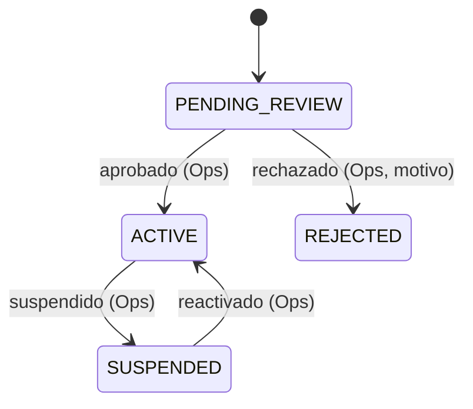
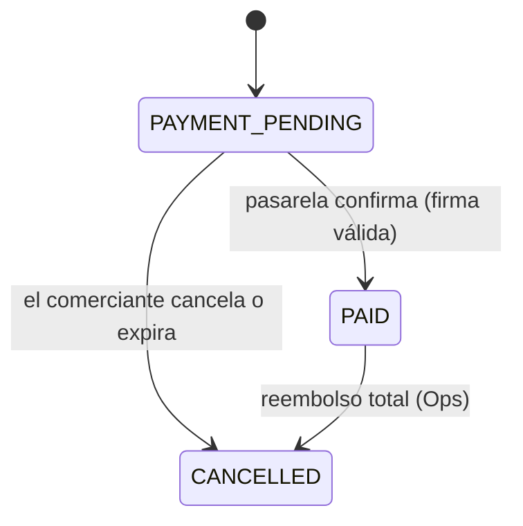
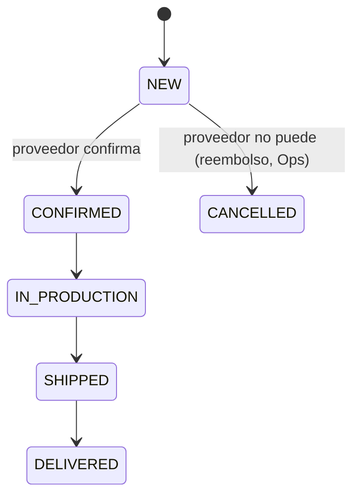

# RFC-0016 — Marketplace mayorista multi-proveedor

| Campo                    | Valor                                                                                                                                                        |
| ------------------------ | ------------------------------------------------------------------------------------------------------------------------------------------------------------ |
| **Estado**               | Aprobado con alcance parcial (2026-11-09): sin checkout ni pagos hasta elegir pasarela (P-01)                                                                |
| **Autor**                | Asistente de desarrollo, a partir de [`docs/design/marketplace-mayorista/analisis-funcional.md`](../docs/design/marketplace-mayorista/analisis-funcional.md) |
| **Revisores**            | Arquitecto · Catálogo · Carrito y precios · Checkout · Identidad · Seguridad · UX · Product Owner                                                            |
| **Creado**               | 2026-11-09                                                                                                                                                   |
| **Última actualización** | 2026-11-09                                                                                                                                                   |
| **ADR generados**        | ADR-0023 (liquidación manual a proveedores) · ADR pendiente de pasarela (ver §10, P-01)                                                                      |
| **Bloque / Sprint**      | Nuevo. Requiere actualizar [`docs/06-implementation-order.md`](../docs/06-implementation-order.md) y [`docs/00-vision.md`](../docs/00-vision.md)             |

> **Decisión de aprobación (2026-11-09, Product Owner).** Se aprueba el RFC **sin checkout**.
> Queda fuera de este alcance todo lo que mueva dinero: `PaymentGatewayPort`, webhooks,
> `POST /checkout`, `MerchantOrder` pagado y `SupplierOrder` creado desde un pago. Eso
> espera a que P-01 (pasarela) se resuelva en un ADR propio. Las preguntas P-02, P-05 a P-07,
> P-09 a P-11 siguen abiertas y bloquean solo los casos de uso que nombran.
>
> **Revisión pendiente.** La aprobación la dio el Product Owner. Los revisores técnicos
> (Arquitecto, Identidad, Seguridad) deben confirmarla antes de cualquier PR de producto.

---

## 1. Problema

Un comerciante de ropa quiere comprar prendas al por mayor a varios proveedores, según la
marca, la tela, el estampado y las tallas que necesita para su tienda. Hoy eso ocurre por
catálogos PDF, listas de precios en hojas de cálculo y pedidos por mensajería: el
comerciante pide a cada proveedor por separado, paga por separado y no sabe el estado de
cada pedido.

Eusse quiere ser el punto único donde se encuentran comerciantes y proveedores. Eusse cobra
al comerciante y paga a los proveedores. Los proveedores necesitan un panel para publicar su
catálogo y gestionar sus pedidos sin depender de Eusse para cada cambio.

El modelo de Eusse World hoy (ver [`docs/00-vision.md`](../docs/00-vision.md)) es distinto:
Eusse vende a clientes B2B con listas de precios que controla. Este RFC introduce proveedores
independientes que fijan sus propios precios. Eso es un cambio de visión que requiere
aprobación del Product Owner (§10, P-08).

## 2. Objetivos y no-objetivos

**Objetivos**

- Registro y aprobación de proveedores con panel propio.
- Publicación de catálogo por proveedor: carga de PDF como respaldo y artículos digitados en
  un formulario.
- Exploración de proveedores y de sus artículos por comerciantes.
- Configuración de un artículo por color, talla y estampado, con precio calculado en el
  servidor.
- Carrito único por comerciante, con subtotales por proveedor y la regla de mínimo de 6
  unidades por proveedor.
- Un pago por pedido, cobrado por Eusse, que se divide en un subpedido por proveedor.
- Gestión de subpedidos por el proveedor y visibilidad para el comerciante.
- Liquidación periódica y manual a proveedores (ADR-0023).

**No-objetivos (explícitos)**

- Pagos divididos o cuentas conectadas de proveedores (diferido; depende de P-01).
- Extracción automática de datos desde PDF (P4 de la decisión aceptada: carga manual).
- Stock en tiempo real por talla (depende de P-05; ver §4.1).
- Reventa con precio propio del comerciante y su publicación a consumidores finales (P-07).
- Chat entre comerciante y proveedor (Fase 3, RFC pendiente).
- Multi-moneda operativa: se deja el puerto de moneda, sin conversión (RFC-0014, P-09).

## 3. Alternativas consideradas

**3.1 Estructura del carrito y del pedido**

| Alternativa                                                                | Ventajas                                             | Inconvenientes                                                                  | Por qué se descarta                                      |
| -------------------------------------------------------------------------- | ---------------------------------------------------- | ------------------------------------------------------------------------------- | -------------------------------------------------------- |
| A. Un carrito por proveedor                                                | Modelo simple; cada pedido es de un solo proveedor   | El comerciante paga N veces y pierde la vista unificada; N pasarelas o N cobros | Mala experiencia para compras de 3+ proveedores          |
| **B. Un carrito y un pedido del comerciante con subpedidos por proveedor** | Un pago, una vista, reparto automático por proveedor | Lógica de reparto y de liquidación más compleja                                 | **Elegida.** Es el modelo de la decisión aceptada (R-03) |
| C. Pedidos independientes que comparten pago                               | Sin agregado padre                                   | Sin garantía de atomicidad del cobro; estados inconsistentes                    | Descartada: rompe la regla de un pago por pedido         |

**3.2 Cobro y pago a proveedores**

| Alternativa                                               | Ventajas                                                 | Inconvenientes                                                                  | Por qué se descarta                                            |
| --------------------------------------------------------- | -------------------------------------------------------- | ------------------------------------------------------------------------------- | -------------------------------------------------------------- |
| A. Pagos divididos desde la pasarela (split)              | Sin liquidación manual; el dinero llega a cada proveedor | Depende de que la pasarela lo soporte para B2B; contrato y cuenta por proveedor | **Diferida** a Fase 2 (P-01). Requiere elegir pasarela antes.  |
| **B. Cobro único a Eusse y liquidación manual periódica** | Independiente de la pasarela; auditable                  | Trabajo operativo; riesgo de error humano (mitigado en ADR-0023)                | **Elegida para Fase 1** (decisión aceptada, ADR-0023)          |
| C. Crédito y transferencia, sin pasarela (ADR-0018)       | Ya diseñado                                              | No es lo que pide el negocio: el comprador paga solo por pasarela               | Descartada para el comprador. Supersede ADR-0018 en este punto |

**3.3 Alta de catálogo**

| Alternativa                                   | Ventajas                               | Inconvenientes                                          | Por qué se descarta                 |
| --------------------------------------------- | -------------------------------------- | ------------------------------------------------------- | ----------------------------------- |
| A. Extracción automática desde PDF            | Menos trabajo para el proveedor        | Calidad incierta; requiere revisión humana y ADR propio | **Diferida** (decisión aceptada P4) |
| **B. Formulario digitado, PDF como respaldo** | Datos fiables; cero dependencia de OCR | Más trabajo para el proveedor                           | **Elegida** (decisión aceptada P4)  |

## 4. Diseño

### 4.1 Modelo de dominio

Contextos afectados: **Suppliers** (nuevo) · **Catalog** (RFC-0005, ampliado) · **Cart**
(RFC-0006, ampliado) · **Orders** (RFC-0007, ampliado) · **Payouts** (nuevo) · **Identity**
y **Accounts** (RFC-0003, ampliados con roles de proveedor y comerciante).

```
Supplier        { id, legalName, taxId (único), status, bankAccountRef, approvedAt, approvedBy }
SupplierProduct { id, supplierId, slug, name, category, basePrice (Money), colors[], sizes[],
                  printOptions[], status (DRAFT|PUBLISHED|ARCHIVED), catalogPdfId? }
PrintOption     { technique (DTF|SCREEN|EMBROIDERY|SUBLIMATION), sizes[], placements[], unitFee (Money) }
MerchantCart    { id, accountId, lines[] }                       -- una por cuenta comerciante
CartLine        { id, supplierId, productId, colorId, qtyBySize{}, print?, pricedAt, unitPrice }
MerchantOrder   { id, accountId, status, shippingAddress, total (Money), paidAt? }   -- raíz
SupplierOrder   { id, merchantOrderId, supplierId, status, lines[], subtotal (Money) }
Payout          { id, supplierId, periodStart, periodEnd, status, net (Money) }
PayoutLine      { id, payoutId, supplierOrderId, amount (Money) }
DesignUpload    { id, accountId, cartLineId?, storageKey, status (PENDING|SAFE|REJECTED), sha256 }
```

**Invariantes**

- **I-1 (mínimo por proveedor).** Para cada `supplierId` del carrito, la suma de unidades
  es ≥ 6 antes de pagar. Se valida en el agregado `MerchantCart` y se revalida en el
  `MerchantOrder` al confirmar el pago.
- **I-2.** Un `MerchantOrder` tiene al menos un `SupplierOrder`, y la suma de los subtotales
  de sus `SupplierOrder` más el envío es igual a `total`.
- **I-3.** Un `SupplierOrder` nace solo cuando el `MerchantOrder` está `PAGADO`.
- **I-4.** `Supplier` solo acepta pedidos y publica productos en estado `ACTIVE`.
- **I-5.** Un `Payout` pagado es inmutable. Un ajuste es un `Payout` nuevo con
  `adjustmentOf` apuntando al original.
- **I-6.** Un `SupplierProduct` solo pasa a `PUBLISHED` si tiene al menos un color, una talla
  y un precio base mayor que cero.
- **I-7.** Un `CartLine` con `print` exige que el proveedor tenga esa técnica activa para ese
  producto, y que `DesignUpload` esté en `SAFE` cuando la técnica lo requiere.

**Dinero.** Todos los importes son `Money` en unidades menores con moneda, según
[`docs/02-domain-model.md`](../docs/02-domain-model.md) y RFC-0006. El redondeo es HALF_UP
en una sola etapa.

**Precio.** `unitPrice = basePrice + print.unitFee`, calculado en el servidor. El precio se
congela en `pricedAt` al agregar la línea. Si el proveedor cambia el precio después, la
línea conserva el precio congelado hasta que se revalide al pagar (RFC-0006).

### 4.2 Casos de uso

Cada caso de uso tendrá su archivo según [`templates/use-case.md`](../templates/use-case.md)
antes de implementarse. Resumen:

| ID     | Caso de uso                              | Actor         | Notas                                                          |
| ------ | ---------------------------------------- | ------------- | -------------------------------------------------------------- |
| UC-S01 | Registrar proveedor                      | Proveedor     | Estado inicial `PENDING_REVIEW`. Datos fiscales obligatorios.  |
| UC-S02 | Aprobar o rechazar proveedor             | Operaciones   | Motivo obligatorio al rechazar. Auditado.                      |
| UC-S03 | Publicar producto                        | Proveedor     | Formulario + PDF de respaldo. Reglas de I-6.                   |
| UC-S04 | Gestionar subpedido                      | Proveedor     | Confirmar, producir, enviar (ver §4.6; envío depende de P-02). |
| UC-S05 | Ver liquidaciones                        | Proveedor     | Solo lectura.                                                  |
| UC-B01 | Explorar proveedores y catálogo          | Comerciante   | Visible solo para proveedores `ACTIVE`.                        |
| UC-B02 | Configurar producto y agregar al carrito | Comerciante   | Color, tallas, cantidades, estampado. Precio desde servidor.   |
| UC-B03 | Subir diseño de estampado                | Comerciante   | Validación y saneado de archivo (§9).                          |
| UC-B04 | Revisar carrito y mínimos                | Comerciante   | Subtotales por proveedor. Faltante por proveedor.              |
| UC-B05 | Pagar pedido                             | Comerciante   | Pasarela (P-01). Revalida I-1, precios y disponibilidad.       |
| UC-B06 | Seguir pedido                            | Comerciante   | Estado por subpedido.                                          |
| UC-O01 | Generar liquidación del periodo          | Sistema + Ops | Ver ADR-0023.                                                  |
| UC-O02 | Registrar transferencia a proveedor      | Operaciones   | Segunda persona distinta de quien prepara (§9).                |
| UC-O03 | Reembolsar o cancelar                    | Operaciones   | Motivo obligatorio. Auditado.                                  |

### 4.3 Contratos

Todas las rutas van bajo `/api/v1` con errores `application/problem+json` y código estable
(RFC-0012). El cuerpo de la petición **nunca** lleva `accountId`, `supplierId` del
comerciante, ni importes: vienen de la sesión y del servidor.

| Método | Ruta                                | Actor       | Errores principales                                                                              |
| ------ | ----------------------------------- | ----------- | ------------------------------------------------------------------------------------------------ |
| POST   | `/suppliers`                        | Proveedor   | `COMMON_VALIDATION_FAILED`, `TAX_ID_ALREADY_REGISTERED`                                          |
| GET    | `/supplier/me`                      | Proveedor   | `COMMON_NOT_FOUND`                                                                               |
| POST   | `/supplier/products`                | Proveedor   | `COMMON_VALIDATION_FAILED`, `SUPPLIER_NOT_ACTIVE`                                                |
| POST   | `/supplier/products/{id}/publish`   | Proveedor   | `COMMON_NOT_FOUND`, `SUPPLIER_PRODUCT_INCOMPLETE`                                                |
| POST   | `/supplier/catalog-pdf`             | Proveedor   | `CATALOG_PDF_INVALID`, `FILE_TOO_LARGE`                                                          |
| GET    | `/supplier/orders`                  | Proveedor   | —                                                                                                |
| POST   | `/supplier/orders/{id}/transitions` | Proveedor   | `COMMON_NOT_FOUND`, `SUPPLIER_INVALID_TRANSITION`                                                |
| GET    | `/suppliers`                        | Comerciante | —                                                                                                |
| GET    | `/suppliers/{id}/products`          | Comerciante | `COMMON_NOT_FOUND` (proveedor no activo o inexistente)                                           |
| POST   | `/cart/lines`                       | Comerciante | `CART_SUPPLIER_MINIMUM_NOT_MET`, `SUPPLIER_PRINT_NOT_AVAILABLE`, `SUPPLIER_NOT_ACTIVE`           |
| GET    | `/cart`                             | Comerciante | —                                                                                                |
| POST   | `/design-uploads`                   | Comerciante | `FILE_TYPE_NOT_ALLOWED`, `FILE_TOO_LARGE`, `FILE_REJECTED`                                       |
| POST   | `/checkout`                         | Comerciante | `CART_SUPPLIER_MINIMUM_NOT_MET`, `PRICING_PRICE_CHANGED`, `ADDRESS_REQUIRED`, `PAYMENT_DECLINED` |
| GET    | `/orders`                           | Comerciante | —                                                                                                |
| POST   | `/webhooks/payments`                | Pasarela    | `WEBHOOK_SIGNATURE_INVALID` (401, sin detalle)                                                   |
| POST   | `/admin/suppliers/{id}/decision`    | Operaciones | `COMMON_NOT_FOUND`, `SUPPLIER_INVALID_TRANSITION`                                                |
| POST   | `/admin/payouts`                    | Operaciones | `PAYOUT_ALREADY_GENERATED`                                                                       |
| POST   | `/admin/payouts/{id}/mark-paid`     | Operaciones | `SAME_ACTOR_FORBIDDEN`, `INVALID_TRANSITION`                                                     |

Los errores de recurso ajeno devuelven `COMMON_NOT_FOUND`, no `FORBIDDEN` (§9).

### 4.4 Interfaces y puertos

| Puerto               | Responsabilidad                                               | Adaptador Fase 1                                     |
| -------------------- | ------------------------------------------------------------- | ---------------------------------------------------- |
| `PaymentGatewayPort` | Crear sesión de cobro, verificar firma de webhook, reembolsar | Pendiente (P-01). Sin adaptador hasta elegir         |
| `StoragePort`        | Guardar PDF y diseños con URL firmada                         | MinIO / S3 (ADR-0017)                                |
| `FileScanPort`       | Analizar archivo antes de marcarlo `SAFE`                     | Pendiente (P-10)                                     |
| `ImageSanitizerPort` | Re-codificar imagen y quitar metadatos                        | Librería de imagen en el servidor (pendiente de ADR) |
| `NotificationPort`   | Avisar a proveedor y comerciante de cambios de estado         | Correo (ADR existente de email)                      |

Sin `PaymentGatewayPort` no se puede implementar el checkout. Por eso P-01 bloquea la
aprobación.

### 4.5 Eventos

Publicados por outbox dentro de la transacción (ADR-0014). Versionados y consumidores
idempotentes por `eventId` (RFC-0013).

| Evento                          | Emisor    | Consumidores                               |
| ------------------------------- | --------- | ------------------------------------------ |
| `supplier.decision_recorded`    | Suppliers | Identity (rol), Notifications              |
| `supplier_product.published`    | Suppliers | Catalog (índice de búsqueda)               |
| `merchant_order.paid`           | Orders    | Suppliers (crea subpedidos), Notifications |
| `supplier_order.status_changed` | Orders    | Notifications                              |
| `payout.generated`              | Payouts   | Notifications                              |
| `payout.paid`                   | Payouts   | Notifications                              |

### 4.6 Estados

**Proveedor**



**Pedido del comerciante**



**Subpedido del proveedor**



Las transiciones inválidas devuelven `INVALID_TRANSITION` y no cambian el estado. Cada
transición es un método del agregado (no un `UPDATE` directo).

**Liquidación:** `PENDING` → `PAID`. `PAID` es final.

### 4.7 Errores

Los códigos ya implementados en `packages/contracts/src/shared/errors.ts` son `CART_SUPPLIER_MINIMUM_NOT_MET`, `SUPPLIER_NOT_ACTIVE`, `SUPPLIER_INVALID_TRANSITION`, `SUPPLIER_PRODUCT_INCOMPLETE` y `SUPPLIER_PRINT_NOT_AVAILABLE`. Los demás de la tabla no existen todavía; se añaden con su caso de uso, con su mapeo HTTP.

| Código                          | HTTP | Cuándo                                               | Qué ve el usuario                                    |
| ------------------------------- | ---- | ---------------------------------------------------- | ---------------------------------------------------- |
| `CART_SUPPLIER_MINIMUM_NOT_MET` | 422  | Al pagar, un proveedor tiene menos de 6 unidades     | "Faltan N unidades para el mínimo de [proveedor]"    |
| `SUPPLIER_PRINT_NOT_AVAILABLE`  | 422  | La técnica no está activa para ese producto          | "Este artículo no admite esa técnica de estampado"   |
| `PRICING_PRICE_CHANGED`         | 409  | El precio de una línea cambió desde `pricedAt`       | "Los precios cambiaron. Revisa tu carrito"           |
| `SUPPLIER_NOT_ACTIVE`           | 409  | El proveedor está suspendido o pendiente             | "Este proveedor no acepta pedidos ahora"             |
| `FILE_TYPE_NOT_ALLOWED`         | 422  | Archivo no PDF (catálogo) o no imagen (diseño)       | "Sube un archivo en el formato indicado"             |
| `FILE_REJECTED`                 | 422  | El análisis de seguridad rechaza el archivo          | "No pudimos usar este archivo"                       |
| `CATALOG_PDF_INVALID`           | 422  | PDF corrupto, protegido o demasiado grande           | "No pudimos leer este PDF"                           |
| `PAYMENT_DECLINED`              | 402  | La pasarela rechaza el pago                          | "Tu pago no se completó. Puedes intentarlo de nuevo" |
| `WEBHOOK_SIGNATURE_INVALID`     | 401  | Firma del webhook no válida                          | (sin detalle; solo registro interno)                 |
| `COMMON_NOT_FOUND`              | 404  | Recurso inexistente o ajeno                          | "No encontramos esto"                                |
| `ORDER_INVALID_TRANSITION`      | 409  | Transición de estado no permitida                    | "Esta acción ya no está disponible"                  |
| `SAME_ACTOR_FORBIDDEN`          | 403  | Quien prepara la liquidación intenta marcarla pagada | "Otra persona debe registrar este pago"              |

### 4.8 Modelo de datos

Un esquema por contexto (ADR-0006), sin llaves foráneas entre contextos. La referencia
entre contextos es un identificador, no una FK.

| Tabla                        | Contexto  | Índices y motivo                                                                    |
| ---------------------------- | --------- | ----------------------------------------------------------------------------------- |
| `suppliers.supplier`         | suppliers | `UNIQUE(tax_id)`. Filtro por `status` para listados.                                |
| `suppliers.supplier_product` | suppliers | `(supplier_id, status)` para el catálogo público.                                   |
| `suppliers.print_option`     | suppliers | `(product_id)`.                                                                     |
| `cart.merchant_cart_line`    | cart      | `(account_id)` y `(account_id, supplier_id)` para agrupar por proveedor.            |
| `orders.merchant_order`      | orders    | `(account_id, created_at desc)` para el historial del comerciante.                  |
| `orders.supplier_order`      | orders    | `(supplier_id, status, created_at)` para el panel del proveedor.                    |
| `payouts.payout`             | payouts   | `UNIQUE(supplier_id, period_start, period_end)` (no hay dos liquidaciones iguales). |
| `payouts.payout_line`        | payouts   | `(payout_id)`.                                                                      |
| `shared.design_upload`       | shared    | `(account_id)`. `sha256` indexado para detectar duplicados.                         |

Migración: todo es nuevo; no hay datos que migrar. Se aplica con migraciones nuevas por
contexto. Cualquier cambio posterior sigue expand → migrate → contract.

Las cantidades por talla se guardan como `jsonb` validado por Zod, igual que los atributos
de RFC-0005.

### 4.9 Interfaz de usuario

**Panel del proveedor (escritorio primero, usable en móvil):** resumen (pedidos nuevos,
pendientes de confirmar, siguiente liquidación) · órdenes con filtro por estado · catálogo
(lista, formulario de producto, carga de PDF de respaldo) · estampados (técnicas y tamaños) ·
liquidaciones (solo lectura).

**Tienda del comerciante:** lista de proveedores con su categoría principal · ficha del
proveedor y su catálogo · producto con selector de color, cuadrícula de tallas y estampado
en tres pasos · carrito agrupado por proveedor, cada grupo con barra de progreso hacia 6 ·
checkout en pasos: dirección → resumen por proveedor → pasarela · pedidos con estado por
subpedido.

**Estados obligatorios** en cada pantalla: cargando (esqueleto, sin salto de diseño), vacío,
error con acción de reintento, parcial (un proveedor con problema no bloquea a los demás) y
éxito.

**Reglas de interfaz:** textos solo por `next-intl` (es/en) · colores y espacios solo por
`@eusse/tokens` · tema claro y oscuro · accesible según checklist de accesibilidad · precios
mostrados tal como los devuelve el servidor. El prototipo en
`docs/design/prototypes/eusse-world-react/plataforma/` es referencia visual; su lógica de
precios y sus datos de ejemplo no se reutilizan.

## 5. Impacto

| Área                | Impacto                                                                                                |
| ------------------- | ------------------------------------------------------------------------------------------------------ |
| Contextos afectados | Suppliers (nuevo), Catalog, Cart, Orders, Payouts (nuevo), Identity, Accounts                          |
| Paquetes afectados  | `@eusse/contracts`, `@eusse/domain`, `@eusse/ui`, `apps/api`, `apps/web`, `apps/admin`, `apps/workers` |
| Cambios rompedores  | Visión de producto (`00-vision.md`). ADR-0018 (pagos) queda superado en el punto del comprador         |
| Migración de datos  | Ninguna (todo nuevo)                                                                                   |
| Rendimiento         | Listados paginados por cursor (RFC-0012). Consultas de carrito indexadas por cuenta                    |
| Seguridad           | Ver §9. Riesgos altos: IDOR entre proveedores, archivos de terceros, cobros                            |
| Accesibilidad       | Estados de error y progreso anunciados; cuadrícula de tallas navegable por teclado                     |
| i18n                | Todos los textos y formatos de moneda por `next-intl`                                                  |
| SEO                 | Fichas de proveedor y producto públicas e indexables; panel y carrito con `noindex`                    |
| Observabilidad      | Métricas de pedidos por estado, tiempo hasta confirmación del proveedor, fallos de pasarela y webhooks |

## 6. Riesgos

| Riesgo                                                       | Prob. | Impacto | Mitigación verificable                                                        |
| ------------------------------------------------------------ | ----- | ------- | ----------------------------------------------------------------------------- |
| Cobro sin subpedido (fallo entre pago confirmado y creación) | Media | Alto    | Test con fallo inyectado; reintento idempotente por `eventId`                 |
| Pago a proveedor incorrecto o duplicado                      | Media | Alto    | `UNIQUE` por periodo; doble control (ADR-0023); test de liquidación repetida  |
| Proveedor ve pedidos de otro proveedor (IDOR)                | Baja  | Alto    | Test de contrato: `404` entre proveedores en todas las rutas de `/supplier/*` |
| Archivo malicioso subido por proveedor o comerciante         | Media | Alto    | `FileScanPort` antes de `SAFE`; test con archivo falso PDF/imagen             |
| Pasarela sin soporte para el modelo de Fase 1                | Media | Alto    | Elegir pasarela con criterios de ADR antes de aprobar (P-01)                  |
| Catálogo con precios incorrectos publicado                   | Media | Medio   | Publicación solo con I-6; revisión de Operaciones (decisión P3)               |
| Comerciante no completa el mínimo por proveedor y abandona   | Alta  | Medio   | Barra de progreso por proveedor; medición de abandono en el carrito           |

## 7. Criterios de aceptación

```gherkin
Escenario: el mínimo se cuenta por proveedor
  Dado un comerciante con 4 camisetas y 2 sudaderas del proveedor A
  Y 3 camisetas del proveedor B
  Cuando intenta pagar
  Entonces el pago no se inicia
  Y el carrito indica que al proveedor B le faltan 3 unidades

Escenario: un proveedor no ve pedidos de otro proveedor
  Dado un subpedido del proveedor A
  Cuando el proveedor B pide ese subpedido por su identificador
  Entonces la respuesta es 404 sin detalle del recurso

Escenario: el importe lo calcula el servidor
  Dado una línea con precio base 4,80 y estampado de 1,20
  Cuando el cliente envía el total 1,00 en la petición
  Entonces el pedido se crea con total calculado en el servidor
  Y el valor enviado por el cliente se ignora

Escenario: webhook con firma inválida
  Dado un webhook de pasarela con firma incorrecta
  Cuando llega a /webhooks/payments
  Entonces la respuesta es 401
  Y el pedido no cambia de estado

Escenario: una liquidación pagada es inmutable
  Dado una liquidación en estado PAID
  Cuando alguien intenta modificar su importe
  Entonces la operación se rechaza con INVALID_TRANSITION
  Y la corrección solo es posible con un ajuste nuevo

Escenario: quien prepara una liquidación no la marca pagada
  Dado una liquidación generada por el usuario U
  Cuando U intenta marcarla como pagada
  Entonces la respuesta es 403 SAME_ACTOR_FORBIDDEN
```

## 8. Plan de implementación

Orden interno obligatorio: Contratos → Dominio → Aplicación → Infraestructura → HTTP → SDK →
UI → E2E. Se inicia solo tras aprobación.

1. Actualizar `docs/00-vision.md` y `docs/06-implementation-order.md` (Product Owner).
2. Elegir pasarela con ADR propio (P-01) y definir `PaymentGatewayPort` real.
3. Contratos en `@eusse/contracts`: schemas de supplier, product, cart, order, payout.
4. Dominio: `Supplier`, `SupplierProduct`, `MerchantCart`, `MerchantOrder`, `SupplierOrder`,
   `Payout`, con tests de invariantes I-1 a I-7.
5. Aplicación y persistencia por contexto, con outbox para los eventos de §4.5.
6. HTTP con los guards de RFC-0003 y los errores de §4.7.
7. UI del panel de proveedor y de la tienda, sobre `@eusse/ui`.
8. E2E: alta de proveedor → publicación → compra de dos proveedores → pago → subpedidos →
   liquidación.

Bloques de trabajo sugeridos, sin fecha: (a) identidad de proveedor y aprobación;
(b) catálogo y publicación; (c) carrito y mínimo; (d) pago y subpedidos; (e) liquidación;
(f) panel de proveedor y tienda.

## 9. Preparación para fases futuras y seguridad

**Seguridad (obligatoria).**

- `accountId` y `supplierId` salen de la sesión, nunca del cuerpo ni de la URL.
- Recursos ajenos: `404`.
- Importes: el cobro se compara con el total del servidor antes de marcar `PAID`.
  Diferencia → no se marca y se registra.
- Webhooks: firma verificada y deduplicados por `eventId`.
- Archivos: tipo real por contenido, límite de tamaño, `FileScanPort` antes de `SAFE`,
  almacenamiento privado, URL firmada de vida corta (`SIGNED_URL_TTL`), saneado de imágenes
  sin metadatos (EXIF). Ningún archivo se sirve desde el origen de la aplicación.
- Datos personales: el proveedor ve del comerciante solo nombre de tienda, dirección de
  entrega y teléfono de contacto de su subpedido.
- Logs sin direcciones, teléfonos ni correos.
- Auditoría: aprobación de proveedores, cambios de precio, cancelaciones, reembolsos y
  liquidaciones, con actor, fecha y motivo.

**No se construye ahora, pero se deja el hueco:**

- Pagos divididos o cuentas de proveedor (`PaymentGatewayPort` con capacidad de split).
- Tracking con transportista (`ShippingPort`, ADR de tracking).
- Reventa del comerciante con precio propio (campo `retailPrice` opcional en `CartLine`,
  sin UI; depende de P-07).
- Multi-moneda operativa (puerto de moneda, RFC-0014).
- Chat comerciante-proveedor (Fase 3, RFC-0010 y canal de tiempo real).

## 10. Preguntas abiertas

| #    | Pregunta                                                                                                                        | Bloquea                         | Resuelta |
| ---- | ------------------------------------------------------------------------------------------------------------------------------- | ------------------------------- | -------- |
| P-01 | **Pasarela de pago.** ¿Qué proveedor de pago se usa en Fase 1, con qué criterios (ADR-0018)? Hay que elegirla antes de aprobar. | Checkout, §4.4, aprobación      | No       |
| P-02 | ¿Quién envía el pedido: el proveedor directo al comerciante, o Eusse centraliza?                                                | UC-S04 (envío), ADR de tracking | No       |
| P-05 | ¿Los proveedores declaran stock por talla y color?                                                                              | Validación en UC-B02, UC-B05    | No       |
| P-06 | Formatos de imagen de diseño, tamaño máximo y si el proveedor revisa el diseño antes de producir.                               | UC-B03 y `ImageSanitizerPort`   | No       |
| P-07 | ¿Eusse cobra comisión sobre el precio del proveedor o tiene otra fuente de ingreso?                                             | Cálculo de `Payout` y R-04      | No       |
| P-08 | ¿El Product Owner acepta el cambio de visión (marketplace multi-proveedor)? Hay que actualizar `docs/00-vision.md`.             | Aprobación del RFC              | No       |
| P-09 | Monedas e impuestos por país (CO, CR, NI, US).                                                                                  | Modelo de `Money` y facturación | No       |
| P-10 | ¿Qué servicio de análisis antivirus se usa para archivos subidos (proveedor o gestionado)?                                      | `FileScanPort` en producción    | No       |
| P-11 | Periodicidad de la liquidación (propuesta semanal, ADR-0023).                                                                   | UC-O01                          | No       |
| P-12 | ¿El comerciante puede pagar con crédito o transferencia en Fase 1, como dice ADR-0018, o solo pasarela?                         | Alcance de pagos                | No       |

**Un RFC no se aprueba con preguntas abiertas que bloqueen.** P-01, P-08 y P-12 bloquean la
aprobación. P-02, P-05 y P-06 bloquean los casos de uso que nombran. P-07, P-09, P-10 y
P-11 bloquean partes concretas de implementación.

## 11. Enlaces

- RFC relacionados: [RFC-0002](RFC-0002-b2b-domain-model.md) (modelo B2B, que este RFC amplía
  para proveedores), [RFC-0003](RFC-0003-identity-and-access.md) (roles),
  [RFC-0005](RFC-0005-catalog-and-search.md), [RFC-0006](RFC-0006-cart-and-b2b-pricing.md),
  [RFC-0007](RFC-0007-checkout-and-orders.md), [RFC-0012](RFC-0012-api-contracts.md),
  [RFC-0013](RFC-0013-domain-and-integration-events.md), [RFC-0014](RFC-0014-i18n-and-multicurrency.md).
- ADR generados: [ADR-0023](../adrs/ADR-0023-manual-supplier-payouts.md).
- ADR afectados: [ADR-0018](../adrs/ADR-0018-payments-port.md) (pagos en Fase 1),
  [ADR-0014](../adrs/ADR-0014-transactional-outbox.md), [ADR-0017](../adrs/ADR-0017-media-storage.md).
- Documentos afectados: [`docs/00-vision.md`](../docs/00-vision.md),
  [`docs/02-domain-model.md`](../docs/02-domain-model.md),
  [`docs/06-implementation-order.md`](../docs/06-implementation-order.md).
- Análisis funcional de origen:
  [`docs/design/marketplace-mayorista/analisis-funcional.md`](../docs/design/marketplace-mayorista/analisis-funcional.md).
- Checklists aplicables: [pre-rfc](../checklists/pre-rfc.md), [security](../checklists/security.md),
  [accessibility](../checklists/accessibility.md), [i18n](../checklists/i18n.md),
  [frontend](../checklists/frontend.md).
